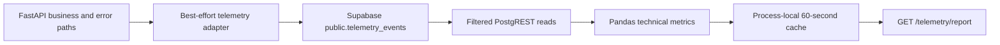

# Phase 1 — Current-State Analysis

Status: repository-verified design documentation. This file makes no runtime, schema, migration, dependency, endpoint, or deployment change.

## 1. Scope and evidence

This analysis establishes the current technical telemetry architecture and the gap between its engineering report and Brasaland's required Weekly Location Cost & Waste Report.

Repository evidence inspected:

- [`docs/telemetry/telemetry-plan.md`](docs/telemetry/telemetry-plan.md) and [`docs/telemetry/event-schemas.json`](docs/telemetry/event-schemas.json);
- [`services/api/app/telemetry.py`](services/api/app/telemetry.py) and its FastAPI integration in [`services/api/app/main.py`](services/api/app/main.py);
- [`services/telemetry/repository.py`](services/telemetry/repository.py), [`services/telemetry/analysis.py`](services/telemetry/analysis.py), [`services/telemetry/router.py`](services/telemetry/router.py), [`services/telemetry/report_period.py`](services/telemetry/report_period.py), and [`services/telemetry/cache.py`](services/telemetry/cache.py);
- telemetry tests under [`services/api/tests/`](services/api/tests/) and [`services/telemetry/tests/`](services/telemetry/tests/);
- dependencies in [`services/api/pyproject.toml`](services/api/pyproject.toml), server configuration in [`.env.example`](.env.example), and API packaging in [`services/api/Dockerfile`](services/api/Dockerfile) and [`docker-compose.yml`](docker-compose.yml);
- reporting-related directories under [`data/pipelines/`](data/pipelines/), [`docs/telemetry/`](docs/telemetry/), [`services/telemetry/`](services/telemetry/), and [`services/reporting/`](services/reporting/).

### Briefing availability

The required `company-BRIEFING.md` is not present anywhere in this repository. The business contract used here is the Brasaland Business Performance Pipeline briefing supplied with this project: a Monday weekly report for Mariana Restrepo and Felipe Guerrero, with one row per location and UTC ISO week in `reporting.weekly_location_performance`. Its five KPIs are Purchase Cost, Waste Cost, Waste Ratio, Stockout Frequency, and Price Alert Frequency.

The missing repository file remains an evidence gap. This document does not claim that an absent `company-BRIEFING.md` was inspected.

## 2. Existing architecture



### 2.1 Telemetry collection

[`services/api/app/telemetry.py`](services/api/app/telemetry.py) contains one generic `persist_telemetry_event()` adapter and seven concrete emitters:

- `staff_login_failed`;
- `protected_route_unauthenticated`;
- `request_validation_rejected`;
- `storage_unavailable`;
- `supplier_created`;
- `supplier_rate_changed`; and
- `supplier_status_changed`.

The global exception handlers in [`services/api/app/main.py`](services/api/app/main.py) attach login, authentication, validation, and storage emission as FastAPI background work so telemetry failure does not change the original HTTP response. Successful supplier create, rate, and status operations emit from the supplier routes only after business persistence succeeds.

Capture is best-effort. Missing Supabase configuration logs and skips the write; HTTP and unexpected failures are logged and swallowed. There is no queue, durable browser buffer, retry worker, or inventory application in the repository.

### 2.2 Event validation

Two contracts currently coexist:

1. [`docs/telemetry/event-schemas.json`](docs/telemetry/event-schemas.json) is a Draft-07 design contract with a closed event envelope, `eventId`, `entity_action`, `schemaVersion`, `requestId`, and nested `properties`.
2. The runtime adapter accepts function arguments without JSON Schema validation and writes `id`, `timestamp`, `service`, `event_type`, `level`, `tags`, and optional `message` and `value`.

No `jsonschema` dependency or runtime validator connects those contracts. The design uses `eventId`/`properties`; the implemented adapter uses a newly generated `id`/`tags`. Pydantic validates API request models, but that is not validation of the telemetry event schema.

### 2.3 Event persistence

Runtime capture posts directly to Supabase REST at `/rest/v1/telemetry_events` with `SUPABASE_URL` and `SUPABASE_SERVICE_ROLE_KEY`. The service-role key remains server-side. Writes request `return=minimal` and use a five-second HTTP timeout.

No SQL file, Supabase migration, checked-in DDL, index, row-level security policy, retention policy, database type definition, or live integration test exists in the repository. Code proves the implemented write payload and expected read columns; it does not prove the live table schema or successful persistence. TinyDB under `services/api` stores supplier and staff data and is not the telemetry source.

### 2.4 Technical analysis

[`services/telemetry/repository.py`](services/telemetry/repository.py) selects only `id`, `timestamp`, `event_type`, `level`, and `tags`. It applies server-side:

- `timestamp >= start`;
- `timestamp < end`;
- optional `event_type in (...)`; and
- ascending timestamp order.

Dates must be timezone-aware. Equal or inverted repository windows return no rows. There is no pagination or PostgREST range handling, so deployment row limits may truncate a large result.

[`services/telemetry/analysis.py`](services/telemetry/analysis.py) uses Pandas to normalize UTC timestamps and tags, then calculates:

- event count per UTC day;
- error percentage per event type, where `level == "error"`;
- event count by a tag dimension, defaulting to `route`; and
- daily authentication failure ratio.

Each metric performs its own repository read for the same uncached report window. The catalogue and capture have no `staff_login_succeeded`, so a day with recorded login failures has an authentication failure ratio of `1.0`; filled zero-attempt days report `0.0`.

Event totals use Pandas `count(id)`, not raw row count. Because the repository does not include DDL proving `id NOT NULL`, null IDs would be omitted; in the error-rate aggregation, error rows with null IDs could also make the numerator inconsistent with the denominator. Correct metric behavior therefore depends on a non-null source ID constraint that must be verified before implementation.

### 2.5 Technical reporting

[`services/telemetry/router.py`](services/telemetry/router.py) exposes unauthenticated `GET /telemetry/report`, mounted by the existing FastAPI app in [`services/api/app/main.py`](services/api/app/main.py).

The route accepts optional `start_date` and `end_date`:

- no dates means a rolling seven-day interval ending at the current instant;
- only `start_date` means that start through the current instant;
- only `end_date` means the default start of current instant minus seven days through that supplied end;
- date-only values mean midnight UTC;
- timestamps without an offset are accepted and treated as UTC;
- offset timestamps are normalized to UTC; and
- the period is half-open: `[start, end)`.

Its response shape is:

```json
{
  "period": {
    "from": "ISO-8601 UTC",
    "to": "ISO-8601 UTC"
  },
  "metrics": {
    "events_per_day": [],
    "error_rate_by_type": [],
    "events_by_dimension": [],
    "auth_failure_rate": []
  }
}
```

Invalid dates or ranges return `422`. Only `TelemetryRepositoryError` failures—such as missing configuration, transport failure, or an HTTP error response—map to `503`. Malformed JSON or another unexpected repository/analysis exception maps to `500`. [`services/telemetry/cache.py`](services/telemetry/cache.py) caches each normalized date range in process memory for 60 seconds. The cache is not shared across workers and is not invalidated when a new event arrives.

### 2.6 Deployment state

The API imports the sibling `services/telemetry` package by modifying its Python path. However, the API Docker build context and development volume include only `services/api`. The documented container therefore does not include the sibling telemetry package unless packaging or build context is changed. This is an existing deployment gap, not a Phase 1 implementation task.

## 3. Existing data capabilities

### 3.1 Event catalogue versus runtime events

The approved telemetry catalogue defines 16 event types, including the six mandatory inventory metrics and supplier/platform events. The business pipeline needs only:

- `inbound_order_created`;
- `outbound_order_created` for context checks;
- `stock_waste_registered`;
- `stock_threshold_triggered`; and
- `ingredient_price_variance_detected`.

None of those five inventory events has a runtime route or emitter in this repository. The seven implemented event types are the supplier and platform events listed in section 2.1.

### 3.2 Available source fields

Fields in the implemented write payload:

- `id`;
- `timestamp`;
- `service`;
- `event_type`;
- `level`;
- `tags`;
- optional `message`; and
- optional `value`.

The technical repository expects and reads only `id`, `timestamp`, `event_type`, `level`, and `tags`. Without checked-in DDL or a live integration test, neither list proves the actual stored schema.

The approved inventory design defines `location_id`, `country`, `product_id`, `product_category`, `quantity`, `unit`, and `currency`. Cost-bearing `inbound_order_created` and `stock_waste_registered` also define `unit_cost`. These fields are design capabilities only until inventory capture persists them.

### 3.3 Existing aggregations and outputs

Existing aggregation is technical and transient:

- daily event volume;
- event-type error rate;
- count by one tag dimension; and
- daily recorded authentication failure rate.

The results are returned from `GET /telemetry/report` and cached briefly. There is no persisted technical aggregate, weekly location aggregate, execution log, reporting schema, reporting migration, or business KPI endpoint.

### 3.4 Dependencies, tests, and configuration

The API declares FastAPI, HTTPX, Pandas, Pydantic, PyJWT, TinyDB, python-dotenv, and Uvicorn. Prefect is not a dependency.

Tests verify:

- telemetry row mapping and failure isolation;
- unchanged API responses when telemetry fails;
- supplier/platform event emission;
- Pandas grouping, UTC conversion, filtering, empty inputs, and tag handling;
- repository error behavior; and
- report periods, output shape, zero filling, cache behavior, `422`, and `503`.

No test verifies the live Supabase schema, runtime JSON Schema validation, inventory event capture, pagination, supplier rate/status emission, malformed Supabase JSON, the report's generic `500` branch, reporting-table behavior, or a business KPI calculation.

Configuration loads root `.env/local`, root `.env`, then `services/api/.env` without overriding existing environment values. Capture silently skips when Supabase credentials are absent; repository reads instead raise an error that the report maps to `503`.

## 4. Business reporting gap

The current technical report helps engineering answer:

- Is telemetry arriving each day?
- Which event types are errors?
- Where are events distributed by a selected technical tag?
- What share of recorded authentication attempts failed?

It does not answer Mariana and Felipe's management question: for each location and completed ISO week, what were purchase cost, waste cost, waste ratio, stockout frequency, and price-alert frequency?

Specific gaps:

1. Inventory business events are designed but not captured.
2. Runtime telemetry does not enforce the approved event envelope or stable producer identity.
3. There is no verified cost-bearing inventory data in the live source.
4. There is no authoritative database-backed registry for all 14 locations, so silence cannot be distinguished from zero activity for a never-seen location.
5. The report uses rolling date windows and engineering metrics, not completed ISO weeks and business dimensions.
6. There is no `reporting` schema, `reporting.weekly_location_performance`, execution log, idempotent business load, or historical business aggregate.
7. There is no status, manual-trigger, or weekly-location-performance API.
8. COP and USD are not modeled in current technical outputs.

The existing report must not be expanded to calculate these business KPIs. It remains an independent engineering capability.

## 5. Reusable components

The business pipeline can reuse these verified patterns without duplicating technical reporting:

- Supabase server-side credentials and HTTP client conventions;
- explicit field projection and event-type filters;
- timezone-aware UTC parsing and half-open ranges;
- normalized error mapping at an API boundary;
- approved inventory event names and property allowlists;
- existing FastAPI application and staff JWT/session dependencies; and
- tests' dependency-injection patterns for clocks, repositories, and metric functions.

The pipeline must not reuse `services/telemetry/analysis.py` for business calculations. Pure business transformations belong under `data/process`, orchestration and pipeline repository access under `data/pipelines`, and thin HTTP adapters under `services/reporting`.

## 6. Architectural boundaries

| Capability | Owner and boundary |
| --- | --- |
| Technical event capture | Existing FastAPI workflows and `services/api/app/telemetry.py`. |
| Raw telemetry persistence | Read-only source for this pipeline: Supabase `public.telemetry_events`. |
| Technical metric calculation | Existing `services/telemetry/analysis.py`; unchanged. |
| Technical reporting API | Existing `GET /telemetry/report`; unchanged. |
| Business validation and KPI calculation | Future pure functions under `data/process`; no technical-analysis import. |
| Business orchestration and data access | Future Prefect flow/tasks and repositories under `data/pipelines`. |
| Business reporting destination | Future tables under `reporting`, never `telemetry_events`. |
| Business reporting API | Future `services/reporting` module mounted into the existing FastAPI/JWT stack, not a second API. |

Dependency direction is `services/reporting` → `data/pipelines` → `data/process`. Pipeline code does not import the HTTP service. Technical and business reporting may read the same raw source but have separate calculations, destinations, and contracts.

## 7. Reporting-related modules and directories

- [`services/telemetry/`](services/telemetry/) — implemented technical repository, analysis, period handling, cache, and route.
- [`services/reporting/`](services/reporting/) — reserved empty boundary; no endpoint is implemented.
- [`data/pipelines/PIPELINE_DESIGN.md`](data/pipelines/PIPELINE_DESIGN.md) — complete business pipeline architecture.
- [`docs/telemetry/business_metrics.md`](docs/telemetry/business_metrics.md) — KPI and reporting API contracts.
- [`docs/telemetry/PREFECT_DESIGN.md`](docs/telemetry/PREFECT_DESIGN.md) — design-only Prefect mapping.

## 8. Unresolved decisions and prerequisites

Before implementation:

1. add the authoritative `company-BRIEFING.md` to the repository or establish another versioned source;
2. obtain or check in the actual Supabase DDL and confirm `telemetry_events.id` uniqueness, JSON type, indexes, RLS, retention, and row limits;
3. implement inventory capture that validates the approved properties, preserves producer `eventId`, and stores those properties in the runtime payload;
4. provide an authoritative location registry;
5. confirm the exact Monday publication time;
6. choose monetary decimal precision;
7. define source pagination and maximum batch size; and
8. package the sibling telemetry, reporting, and pipeline modules into the existing API deployment without creating another service or auth stack.

## 9. Phase 1 conclusion

The repository has a working best-effort technical telemetry path and engineering report, but it does not yet have the source completeness, business transformations, durable reporting destination, orchestration, or API contracts implemented for the Weekly Location Cost & Waste Report. The verified current state supports designing that pipeline; it does not support claiming that the business report can run today.

The detailed future design remains in [`data/pipelines/PIPELINE_DESIGN.md`](data/pipelines/PIPELINE_DESIGN.md). This Phase 1 deliverable introduces no implementation change.
