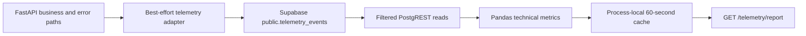

# Brasaland Business Performance Pipeline Design

Status: repository-verified Phase 1–3 design documentation. This file makes no runtime, schema, migration, dependency, endpoint, or deployment change.

## 1. Scope and evidence

This analysis establishes the current technical telemetry architecture and the gap between its engineering report and Brasaland's required Weekly Location Cost & Waste Report.

Repository evidence inspected:

- [`docs/telemetry/telemetry-plan.md`](docs/telemetry/telemetry-plan.md) and [`docs/telemetry/event-schemas.json`](docs/telemetry/event-schemas.json);
- [`services/api/app/telemetry.py`](services/api/app/telemetry.py) and its FastAPI integration in [`services/api/app/main.py`](services/api/app/main.py);
- [`services/telemetry/repository.py`](services/telemetry/repository.py), [`services/telemetry/analysis.py`](services/telemetry/analysis.py), [`services/telemetry/router.py`](services/telemetry/router.py), [`services/telemetry/report_period.py`](services/telemetry/report_period.py), and [`services/telemetry/cache.py`](services/telemetry/cache.py);
- telemetry tests under [`services/api/tests/`](services/api/tests/) and [`services/telemetry/tests/`](services/telemetry/tests/);
- dependencies in [`services/api/pyproject.toml`](services/api/pyproject.toml), server configuration in [`.env.example`](.env.example), and API packaging in [`services/api/Dockerfile`](services/api/Dockerfile) and [`docker-compose.yml`](docker-compose.yml);
- reporting-related directories under [`data/pipelines/`](data/pipelines/), [`docs/telemetry/`](docs/telemetry/), [`services/telemetry/`](services/telemetry/), and [`services/reporting/`](services/reporting/).

### Briefing availability

The business contract is [`company-BRIEFING.md`](company-BRIEFING.md): a Monday weekly report for Mariana Restrepo and Felipe Guerrero, with one row per location and UTC ISO week in `reporting.weekly_location_performance`. Its five KPIs are Purchase Cost, Waste Cost, Waste Ratio, Stockout Frequency, and Price Alert Frequency.

## 2. Existing architecture



### 2.1 Telemetry collection

[`services/api/app/telemetry.py`](services/api/app/telemetry.py) contains one generic `persist_telemetry_event()` adapter and seven concrete emitters:

- `staff_login_failed`;
- `protected_route_unauthenticated`;
- `request_validation_rejected`;
- `storage_unavailable`;
- `supplier_created`;
- `supplier_rate_changed`; and
- `supplier_status_changed`.

The global exception handlers in [`services/api/app/main.py`](services/api/app/main.py) attach login, authentication, validation, and storage emission as FastAPI background work so telemetry failure does not change the original HTTP response. Successful supplier create, rate, and status operations emit from the supplier routes only after business persistence succeeds.

Capture is best-effort. Missing Supabase configuration logs and skips the write; HTTP and unexpected failures are logged and swallowed. There is no queue, durable browser buffer, retry worker, or inventory application in the repository.

### 2.2 Event validation

Two contracts currently coexist:

1. [`docs/telemetry/event-schemas.json`](docs/telemetry/event-schemas.json) is a Draft-07 design contract with a closed event envelope, `eventId`, `entity_action`, `schemaVersion`, `requestId`, and nested `properties`.
2. The runtime adapter accepts function arguments without JSON Schema validation and writes `id`, `timestamp`, `service`, `event_type`, `level`, `tags`, and optional `message` and `value`.

No `jsonschema` dependency or runtime validator connects those contracts. The design uses `eventId`/`properties`; the implemented adapter uses a newly generated `id`/`tags`. Pydantic validates API request models, but that is not validation of the telemetry event schema.

### 2.3 Event persistence

Runtime capture posts directly to Supabase REST at `/rest/v1/telemetry_events` with `SUPABASE_URL` and `SUPABASE_SERVICE_ROLE_KEY`. The service-role key remains server-side. Writes request `return=minimal` and use a five-second HTTP timeout.

No SQL file, Supabase migration, checked-in DDL, index, row-level security policy, retention policy, database type definition, or live integration test exists in the repository. Code proves the implemented write payload and expected read columns; it does not prove the live table schema or successful persistence. TinyDB under `services/api` stores supplier and staff data and is not the telemetry source.

### 2.4 Technical analysis

[`services/telemetry/repository.py`](services/telemetry/repository.py) selects only `id`, `timestamp`, `event_type`, `level`, and `tags`. It applies server-side:

- `timestamp >= start`;
- `timestamp < end`;
- optional `event_type in (...)`; and
- ascending timestamp order.

Dates must be timezone-aware. Equal or inverted repository windows return no rows. There is no pagination or PostgREST range handling, so deployment row limits may truncate a large result.

[`services/telemetry/analysis.py`](services/telemetry/analysis.py) uses Pandas to normalize UTC timestamps and tags, then calculates:

- event count per UTC day;
- error percentage per event type, where `level == "error"`;
- event count by a tag dimension, defaulting to `route`; and
- daily authentication failure ratio.

Each metric performs its own repository read for the same uncached report window. The catalogue and capture have no `staff_login_succeeded`, so a day with recorded login failures has an authentication failure ratio of `1.0`; filled zero-attempt days report `0.0`.

Event totals use Pandas `count(id)`, not raw row count. Because the repository does not include DDL proving `id NOT NULL`, null IDs would be omitted; in the error-rate aggregation, error rows with null IDs could also make the numerator inconsistent with the denominator. Correct metric behavior therefore depends on a non-null source ID constraint that must be verified before implementation.

### 2.5 Technical reporting

[`services/telemetry/router.py`](services/telemetry/router.py) exposes unauthenticated `GET /telemetry/report`, mounted by the existing FastAPI app in [`services/api/app/main.py`](services/api/app/main.py).

The route accepts optional `start_date` and `end_date`:

- no dates means a rolling seven-day interval ending at the current instant;
- only `start_date` means that start through the current instant;
- only `end_date` means the default start of current instant minus seven days through that supplied end;
- date-only values mean midnight UTC;
- timestamps without an offset are accepted and treated as UTC;
- offset timestamps are normalized to UTC; and
- the period is half-open: `[start, end)`.

Its response shape is:

```json
{
  "period": {
    "from": "ISO-8601 UTC",
    "to": "ISO-8601 UTC"
  },
  "metrics": {
    "events_per_day": [],
    "error_rate_by_type": [],
    "events_by_dimension": [],
    "auth_failure_rate": []
  }
}
```

Invalid dates or ranges return `422`. Only `TelemetryRepositoryError` failures—such as missing configuration, transport failure, or an HTTP error response—map to `503`. Malformed JSON or another unexpected repository/analysis exception maps to `500`. [`services/telemetry/cache.py`](services/telemetry/cache.py) caches each normalized date range in process memory for 60 seconds. The cache is not shared across workers and is not invalidated when a new event arrives.

### 2.6 Deployment state

The API imports the sibling `services/telemetry` package by modifying its Python path. However, the API Docker build context and development volume include only `services/api`. The documented container therefore does not include the sibling telemetry package unless packaging or build context is changed. This is an existing deployment gap, not a Phase 1 implementation task.

## 3. Existing data capabilities

### 3.1 Event catalogue versus runtime events

The approved telemetry catalogue defines 16 event types, including the six mandatory inventory metrics and supplier/platform events. The business pipeline needs only:

- `inbound_order_created`;
- `outbound_order_created` for context checks;
- `stock_waste_registered`;
- `stock_threshold_triggered`; and
- `ingredient_price_variance_detected`.

None of those five inventory events has a runtime route or emitter in this repository. The seven implemented event types are the supplier and platform events listed in section 2.1.

### 3.2 Available source fields

Fields in the implemented write payload:

- `id`;
- `timestamp`;
- `service`;
- `event_type`;
- `level`;
- `tags`;
- optional `message`; and
- optional `value`.

The technical repository expects and reads only `id`, `timestamp`, `event_type`, `level`, and `tags`. Without checked-in DDL or a live integration test, neither list proves the actual stored schema.

The approved inventory design defines `location_id`, `country`, `product_id`, `product_category`, `quantity`, `unit`, and `currency`. Cost-bearing `inbound_order_created` and `stock_waste_registered` also define `unit_cost`. These fields are design capabilities only until inventory capture persists them.

### 3.3 Existing aggregations and outputs

Existing aggregation is technical and transient:

- daily event volume;
- event-type error rate;
- count by one tag dimension; and
- daily recorded authentication failure rate.

The results are returned from `GET /telemetry/report` and cached briefly. There is no persisted technical aggregate, weekly location aggregate, execution log, reporting schema, reporting migration, or business KPI endpoint.

### 3.4 Dependencies, tests, and configuration

The API declares FastAPI, HTTPX, Pandas, Pydantic, PyJWT, TinyDB, python-dotenv, and Uvicorn. Prefect is not a dependency.

Tests verify:

- telemetry row mapping and failure isolation;
- unchanged API responses when telemetry fails;
- supplier/platform event emission;
- Pandas grouping, UTC conversion, filtering, empty inputs, and tag handling;
- repository error behavior; and
- report periods, output shape, zero filling, cache behavior, `422`, and `503`.

No test verifies the live Supabase schema, runtime JSON Schema validation, inventory event capture, pagination, supplier rate/status emission, malformed Supabase JSON, the report's generic `500` branch, reporting-table behavior, or a business KPI calculation.

Configuration loads root `.env/local`, root `.env`, then `services/api/.env` without overriding existing environment values. Capture silently skips when Supabase credentials are absent; repository reads instead raise an error that the report maps to `503`.

## 4. Business reporting gap

The current technical report helps engineering answer:

- Is telemetry arriving each day?
- Which event types are errors?
- Where are events distributed by a selected technical tag?
- What share of recorded authentication attempts failed?

It does not answer Mariana and Felipe's management question: for each location and completed ISO week, what were purchase cost, waste cost, waste ratio, stockout frequency, and price-alert frequency?

Specific gaps:

1. Inventory business events are designed but not captured.
2. Runtime telemetry does not enforce the approved event envelope or stable producer identity.
3. There is no verified cost-bearing inventory data in the live source.
4. There is no authoritative database-backed registry for all 14 locations, so silence cannot be distinguished from zero activity for a never-seen location.
5. The report uses rolling date windows and engineering metrics, not completed ISO weeks and business dimensions.
6. There is no `reporting` schema, `reporting.weekly_location_performance`, execution log, idempotent business load, or historical business aggregate.
7. There is no status, manual-trigger, or weekly-location-performance API.
8. COP and USD are not modeled in current technical outputs.

The existing report must not be expanded to calculate these business KPIs. It remains an independent engineering capability.

## 5. Reusable components

The business pipeline can reuse these verified patterns without duplicating technical reporting:

- Supabase server-side credentials and HTTP client conventions;
- explicit field projection and event-type filters;
- timezone-aware UTC parsing and half-open ranges;
- normalized error mapping at an API boundary;
- approved inventory event names and property allowlists;
- existing FastAPI application and staff JWT/session dependencies; and
- tests' dependency-injection patterns for clocks, repositories, and metric functions.

The pipeline must not reuse `services/telemetry/analysis.py` for business calculations. Pure business transformations belong under `data/process`, orchestration and pipeline repository access under `data/pipelines`, and thin HTTP adapters under `services/reporting`.

## 6. Architectural boundaries

| Capability | Owner and boundary |
| --- | --- |
| Technical event capture | Existing FastAPI workflows and `services/api/app/telemetry.py`. |
| Raw telemetry persistence | Read-only source for this pipeline: Supabase `public.telemetry_events`. |
| Technical metric calculation | Existing `services/telemetry/analysis.py`; unchanged. |
| Technical reporting API | Existing `GET /telemetry/report`; unchanged. |
| Business validation and KPI calculation | Future pure functions under `data/process`; no technical-analysis import. |
| Business orchestration and data access | Future Prefect flow/tasks and repositories under `data/pipelines`. |
| Business reporting destination | Future tables under `reporting`, never `telemetry_events`. |
| Business reporting API | Future `services/reporting` module mounted into the existing FastAPI/JWT stack, not a second API. |

Dependency direction is `services/reporting` → `data/pipelines` → `data/process`. Pipeline code does not import the HTTP service. Technical and business reporting may read the same raw source but have separate calculations, destinations, and contracts.

## 7. Reporting-related modules and directories

- [`services/telemetry/`](services/telemetry/) — implemented technical repository, analysis, period handling, cache, and route.
- [`services/reporting/`](services/reporting/) — reserved empty boundary; no endpoint is implemented.
- [`data/pipelines/PIPELINE_DESIGN.md`](data/pipelines/PIPELINE_DESIGN.md) — complete business pipeline architecture.
- [`docs/telemetry/business_metrics.md`](docs/telemetry/business_metrics.md) — KPI and reporting API contracts.
- [`docs/telemetry/PREFECT_DESIGN.md`](docs/telemetry/PREFECT_DESIGN.md) — design-only Prefect mapping.

## 8. Unresolved decisions and prerequisites

Before implementation:

1. obtain or check in the actual Supabase DDL and confirm `telemetry_events.id` uniqueness, JSON type, indexes, RLS, retention, and row limits;
2. implement inventory capture that validates the approved properties, preserves producer `eventId`, and stores those properties in the runtime payload;
3. provide an authoritative location registry;
4. confirm the exact Monday publication time;
5. choose monetary decimal precision;
6. define source pagination and maximum batch size; and
7. package the sibling telemetry, reporting, and pipeline modules into the existing API deployment without creating another service or auth stack.

## 9. Phase 1 conclusion

The repository has a working best-effort technical telemetry path and engineering report, but it does not yet have the source completeness, business transformations, durable reporting destination, orchestration, or API contracts implemented for the Weekly Location Cost & Waste Report. The verified current state supports designing that pipeline; it does not support claiming that the business report can run today.

The detailed implementation-oriented design remains in [`data/pipelines/PIPELINE_DESIGN.md`](data/pipelines/PIPELINE_DESIGN.md). Phase 1 introduces no implementation change.

## 10. Phase 2 — Business question and objectives

**Business question (derived from [`company-BRIEFING.md`](company-BRIEFING.md)):** For each Brasaland location in Colombia and Florida, how much did it spend and waste during the most recently completed ISO week, how large was waste relative to purchases, and how often did stockouts or abnormal ingredient-price alerts occur?

The deliverable is the **Weekly Location Cost & Waste Report**. Its audience is Mariana Restrepo (CEO) and Felipe Guerrero (Operations Director). It supports four decisions:

1. compare location spending and identify where purchasing concentrates;
2. prioritize waste audits using monetary loss and waste efficiency;
3. review replenishment where threshold crossings indicate service risk; and
4. intervene with suppliers when abnormal price alerts recur.

This connects to Brasaland's objective of replacing delayed phone calls and weekly spreadsheets with centralized, Monday-morning operational evidence. Required measurements are Purchase Cost per Location, Waste Cost per Location, Waste Ratio, Stockout Frequency, and Price Alert Frequency.

The business question, KPIs, aggregation grain, and destination below are derived from [`company-BRIEFING.md`](company-BRIEFING.md).

## 11. KPI definitions

All KPIs use one completed UTC ISO week: Monday `00:00:00` inclusive through the next Monday exclusive. Reporting runs weekly on Monday morning. The aggregation grain is one row per `(location_id, week_start)`; `country` and `currency` are carried dimensions. COP and USD are never converted or combined.

### 11.1 Purchase Cost per Location

- **Definition:** Cost of ingredients received by one location during the week.
- **Formula:** `sum(quantity * unit_cost)`.
- **Source event:** `inbound_order_created`.
- **Source fields:** `id`, `timestamp`, `tags.location_id`, `tags.country`, `tags.quantity`, `tags.unit_cost`, `tags.currency`.
- **Dimensions:** location, country, ISO week, currency.
- **Unit:** local currency amount, `COP` or `USD`.
- **Destination:** `total_purchase_cost`.
- **Limitation:** the approved schema defines `unit_cost`, but no runtime inventory emitter proves live availability or unit compatibility.

### 11.2 Waste Cost per Location

- **Definition:** Monetary value lost through expired product, kitchen error, or suspected theft at one location during the week.
- **Formula:** `sum(quantity * unit_cost)`.
- **Source event:** `stock_waste_registered`.
- **Source fields:** `id`, `timestamp`, `tags.location_id`, `tags.country`, `tags.quantity`, `tags.unit_cost`, `tags.currency`, `tags.reason`.
- **Dimensions:** location, country, ISO week, currency; reason is retained for audit but is not destination grain.
- **Unit:** local currency amount, `COP` or `USD`.
- **Destination:** `total_waste_cost`.
- **Limitation:** `unit_cost` is present in the approved event design but not proven in runtime capture; valuation uses event-time cost, not replacement cost.

### 11.3 Waste Ratio

- **Definition:** Share of weekly purchase cost lost as waste.
- **Formula:** `total_waste_cost / total_purchase_cost`; the briefing requires `0` when purchase cost is `0`.
- **Sources:** the purchase and waste aggregates above.
- **Dimensions:** location, country, ISO week, currency.
- **Unit:** decimal ratio; `0.072` means `7.2%`.
- **Destination:** `waste_ratio`.
- **Limitation:** a zero denominator result does not prove efficiency and must be interpreted with `total_purchase_cost`; country/currency conflicts invalidate the row.

### 11.4 Stockout Frequency

- **Definition:** Number of threshold-crossing events for a location during the week.
- **Formula:** `count(distinct id)` for valid `stock_threshold_triggered` events.
- **Source fields:** `id`, `timestamp`, `tags.location_id`, `tags.country`, `tags.currency`.
- **Dimensions:** location, country, ISO week.
- **Unit:** event count.
- **Destination:** `stockout_events_count`.
- **Limitation:** accuracy requires one event per threshold crossing and stable producer identity; no runtime inventory emitter exists.

### 11.5 Price Alert Frequency

- **Definition:** Number of abnormal ingredient-price variance alerts for a location during the week.
- **Formula:** `count(distinct id)` for valid `ingredient_price_variance_detected` events.
- **Source fields:** `id`, `timestamp`, `tags.location_id`, `tags.country`, `tags.currency`.
- **Dimensions:** location, country, ISO week.
- **Unit:** event count.
- **Destination:** `price_alert_events_count`.
- **Limitation:** accuracy depends on an upstream historical-price baseline, alert threshold, and stable producer identity; none is runtime-proven in this repository.

The full metric contract is [`docs/telemetry/business_metrics.md`](docs/telemetry/business_metrics.md).

## 12. Extraction architecture

### 12.1 Source and filters

The read-only source is Supabase `public.telemetry_events`. Because no database DDL or live integration test is checked in, database types cannot be verified and are not guessed:

| Column | Implemented application representation | Database type |
| --- | --- | --- |
| `id` | UUID-formatted string generated by capture and used as the row identifier | Unverified; DDL required |
| `timestamp` | ISO 8601 string parsed as a UTC datetime | Unverified; DDL required |
| `event_type` | String | Unverified; DDL required |
| `tags` | Object on write; repository/analysis accepts an object or JSON-encoded object string | Unverified; DDL required |

Extraction filters `event_type` to:

1. `inbound_order_created`;
2. `outbound_order_created`;
3. `stock_waste_registered`;
4. `stock_threshold_triggered`; and
5. `ingredient_price_variance_detected`.

`outbound_order_created` is context for volume and collection checks, not a v1 KPI input. The timestamp predicate is half-open: `timestamp >= window_start` and `timestamp < window_end`.

The approved closed payload contract must be validated in full before selecting KPI fields:

| Event type | Required `tags` fields |
| --- | --- |
| `inbound_order_created` | `location_id`, `country`, `supplier_id`, `product_id`, `product_category`, `quantity`, `unit`, `currency`, `unit_cost` |
| `outbound_order_created` | `location_id`, `country`, `product_id`, `product_category`, `quantity`, `unit`, `currency` |
| `stock_waste_registered` | `location_id`, `country`, `product_id`, `product_category`, `quantity`, `unit`, `currency`, `unit_cost`, `reason` |
| `stock_threshold_triggered` | `location_id`, `country`, `product_id`, `product_category`, `quantity`, `unit`, `currency`, `threshold_quantity` |
| `ingredient_price_variance_detected` | `location_id`, `country`, `supplier_id`, `product_id`, `product_category`, `quantity`, `unit`, `currency`, `unit_cost`, `historical_unit_cost`, `variance_ratio`, `threshold_ratio` |

### 12.2 Time, incrementality, and batches

- Source timestamps are parsed as timezone-aware UTC.
- ISO week assignment uses event time, not receipt or processing time.
- The scheduled window ends at Monday `00:00 UTC` and rereads a 14-day overlap, recomputing the prior two complete weeks so late arrivals correct aggregates.
- The successful upper bound is the watermark; it advances only after load and reconciliation succeed.
- First runs and historical backfills require explicit bounded start/end values.
- Extraction uses keyset pages ordered by `(timestamp ASC, id ASC)` with a proposed configurable default `batch_size = 500`. After each full page, the next predicate is `timestamp > last_timestamp OR (timestamp = last_timestamp AND id > last_id)`, still bounded by `timestamp < window_end`; a short page ends extraction. The current repository orders only by timestamp and has no pagination, so the ID tie-breaker, cursor predicate, and limit are required implementation additions.
- Stable producer `eventId` must be persisted as `telemetry_events.id` and reused on delivery retries before `id` can be a reliable deduplication key.
- If a future mutable source is introduced, it must expose stable primary key plus `updated_at`; extraction then uses a composite `(updated_at, primary_key)` watermark and recomputes affected weeks.

The extraction output is an immutable, run-scoped collection containing source `id`, UTC `timestamp`, `event_type`, parsed `tags`, source-window bounds, and extracted/duplicate counts.

## 13. Transformation architecture

The approved root event schema contains envelope fields that runtime persistence does not store, including `sessionId`, `userId`, `entity_action`, `schemaVersion`, and `requestId`. The pipeline therefore cannot honestly reconstruct or revalidate the complete envelope from `telemetry_events`. Full root-`oneOf` validation is an upstream inventory-capture prerequisite. A run must fail source-readiness checks when that validation/version guarantee is absent.

For fields that are persisted, transformation validates `id` and `timestamp` plus `tags` against the exact event-specific `properties` definition in [`docs/telemetry/event-schemas.json`](docs/telemetry/event-schemas.json). That includes `additionalProperties: false`, JSON types, identifier patterns, country/category/reason enums, unit limits, positive quantities and money, nonnegative threshold quantities, numeric variance ratios, and positive threshold ratios.

For each extracted event:

1. validate a parseable UTC timestamp and recognized event type;
2. apply the complete closed event-specific property schema before selecting the KPI subset in section 11;
3. normalize `country`/`currency` to the allowed pairs `CO`/`COP` and `US`/`USD`;
4. validate positive `quantity` and `unit_cost` for cost events;
5. deduplicate by stable source `id`, failing on conflicting payloads for one ID;
6. assign the UTC ISO Monday;
7. calculate purchase or waste line cost with decimal arithmetic;
8. filter `outbound_order_created` from KPI aggregation after retaining its audit count;
9. group by `location_id`, `country`, `week_start`, and `currency`; and
10. calculate the five destination fields.

Missing `tags`, required values, timestamps, or cost inputs are not coerced to zero. An invalid KPI-bearing event fails transformation before any requested week is published. A malformed context-only outbound event may be rejected and counted without altering KPI values. Country/currency conflict fails the run.

An absent location is not interpreted as zero because the repository has no authoritative location registry. Until that dependency exists, output coverage is explicitly observed locations only.

## 14. Loading architecture

The exact briefing destination is:

```sql
create table reporting.weekly_location_performance (
  id uuid primary key default gen_random_uuid(),
  location_id text not null,
  country text not null,
  week_start date not null,
  total_purchase_cost numeric not null default 0,
  total_waste_cost numeric not null default 0,
  waste_ratio numeric not null default 0,
  stockout_events_count integer not null default 0,
  price_alert_events_count integer not null default 0,
  currency text not null,
  computed_at timestamptz not null default now(),
  unique (location_id, week_start)
);
```

This DDL is documentation only. No migration or table is created in Phase 2.

- **Schema/table:** `reporting.weekly_location_performance`.
- **Primary key:** generated `id`.
- **Business uniqueness:** `(location_id, week_start)`.
- **Grain:** one location and completed UTC ISO week.
- **Load behavior:** one transaction for the complete requested window; `INSERT ... ON CONFLICT (location_id, week_start) DO UPDATE` replaces every KPI, country, currency, and `computed_at`, then deletes stale location-week rows absent from the recomputed set for each affected week.
- **History:** prior weeks remain; a late-data overlap or bounded backfill deterministically replaces only affected weekly rows.
- **Currency:** no conversion and no cross-currency aggregate.

A proposed `reporting.pipeline_runs` table records source bounds, affected weeks, counts, status, and version. It has a logical operational relationship to the weekly rows through `affected_weeks` and timestamps; the authoritative destination DDL has no `run_id` foreign key, so this design does not invent one.

## 15. Phase 2 ETL diagram

```mermaid
flowchart LR
    subgraph extractStage [Extraction]
        Source["public.telemetry_events (read only)"]
        Select["Select id, timestamp, event_type, tags"]
        Filter["Five event types + bounded UTC overlap"]
        Batch["Page and deduplicate by stable id"]
        Source --> Select --> Filter --> Batch
    end

    subgraph transformStage [Transformation]
        Validate["Validate payload, time, country, currency, costs"]
        Normalize["Assign UTC ISO week and decimal line costs"]
        Aggregate["Aggregate five KPIs by location and week"]
        Batch --> Validate --> Normalize --> Aggregate
    end

    subgraph loadStage [Loading]
        Upsert["Transactional upsert on location_id + week_start"]
        Destination["reporting.weekly_location_performance"]
        RunLog["reporting.pipeline_runs metadata"]
        Aggregate --> Upsert --> Destination
        Upsert --> RunLog
    end
```



Extraction reads raw telemetry without mutation. Transformation owns business rules. Loading writes only to `reporting`; it never writes to `telemetry_events`.

## 16. Phase 2 boundaries and conclusion

- Existing `services/telemetry/analysis.py` and `GET /telemetry/report` remain technical capabilities and are unchanged.
- Pure business validation and KPI calculations belong under future `data/process`.
- Pipeline orchestration and source/destination access belong under future `data/pipelines`.
- Future `services/reporting` routes are thin adapters mounted into the existing FastAPI/JWT stack.
- No Prefect code, pipeline code, endpoint, dependency, migration, or table is implemented in this phase.

Phase 2 provides a traceable design from Brasaland's weekly management question through source events, verified runtime columns, proposed business fields, deterministic KPI formulas, ETL stages, and the exact briefing destination. Runtime implementation remains blocked on the inventory emitters, stable event identity, authoritative location registry, live Supabase DDL, and approved operational configuration already listed in section 8.

## 17. Phase 3 — Idempotency

A failed or repeated run must not silently inflate purchase or waste totals, invent duplicate destination rows, or publish half a week.

### 17.1 Business keys and destination uniqueness

- Source natural key for deduplication: stable producer `eventId` persisted as `telemetry_events.id` and reused on transmission retries. The current fresh-ID-per-write adapter is not sufficient for at-least-once inventory delivery.
- Destination composite business key: `(location_id, week_start)`.
- Destination unique constraint: `unique (location_id, week_start)` on `reporting.weekly_location_performance`.
- Destination primary key: generated `id`; it is not used for idempotent replacement.

### 17.2 Upsert and replacement strategy

Load uses one database transaction for every weekly partition in the requested window:

```sql
INSERT ... ON CONFLICT (location_id, week_start) DO UPDATE
```

The update replaces `country`, `currency`, all five KPI fields, and `computed_at` from a complete recomputation. It never adds new totals onto old totals. Within the same transaction, after upserting the recomputed set for each `week_start` in `affected_weeks`, delete any existing `reporting.weekly_location_performance` row for that week whose `location_id` is absent from the recomputed set. That reconcile step prevents a successful narrower recompute from leaving stale location-week rows. If the load transaction fails, it rolls back; no half-published partition remains.

### 17.3 Overlapping extraction windows

Scheduled runs re-read a 14-day UTC overlap ending at Monday `00:00`. That overlap intentionally recomputes the prior two complete ISO weeks. Because aggregates are recomputed from source and replaced by upsert, rereading the same events does not create second reporting rows or double-count KPIs. Events older than the overlap require an explicit bounded backfill for the affected week.

### 17.4 Repeated manual execution

Only one `weekly_location_cost_waste` run may hold a live renewable lease. A second schedule, manual, or backfill trigger while that lease is valid receives `409 Conflict` with the active `run_id`. Serialization begins before extraction so an older extract cannot overwrite a newer result. After a successful completed week, a later manual rerun for the same week is safe: it recomputes and upserts the same `(location_id, week_start)` keys.

### 17.5 Partial batch failures

Extraction pages by `(timestamp ASC, id ASC)`. An interrupted or incomplete page set is discarded; extraction restarts the bounded window from the beginning rather than committing a truncated extract. If a KPI-bearing record is invalid, transformation fails before load and no destination rows from that run are published. Context-only malformed `outbound_order_created` events may be rejected and counted without changing KPIs. There is no partial successful publication of a known understated week.

### 17.6 Historical recalculation

Historical correction uses the same extract → transform → load path with explicit week bounds and `trigger_type = backfill`. Only the requested partitions are recomputed and replaced. Prior unaffected weeks remain. Watermark advancement for scheduled incremental progress happens only after a successful load and reconciliation; a failed backfill does not rewrite the successful incremental watermark.

## 18. Phase 3 — Observability

### 18.1 Proposed execution record

The proposed `reporting.pipeline_runs` control table is documentation only. Required operational fields:

| Field | Type | Purpose |
| --- | --- | --- |
| `run_id` | `uuid` | Correlates API responses, orchestration logs, and alerts for one execution. |
| `pipeline_name` | `text` | Distinguishes this pipeline from future reporting jobs. |
| `trigger_type` | `text` | `schedule`, `manual`, or `backfill`. |
| `requested_week_start` | `date` | Week requested by the trigger. |
| `affected_weeks` | `date[]` | Every destination partition recomputed by the run. |
| `started_at` | `timestamptz` | Execution start. |
| `finished_at` | `timestamptz nullable` | Execution end. |
| `heartbeat_at` | `timestamptz nullable` | Distinguishes a live run from an orphan. |
| `lease_expires_at` | `timestamptz nullable` | Enables safe takeover after a crash. |
| `status` | `text` | `running`, `success`, or `failed`. |
| `last_completed_stage` | `text nullable` | Audit marker for the last stage that finished. It is not a mid-stage resume pointer; recovery restarts the bounded window. |
| `watermark_from` | `timestamptz` | Inclusive source lower bound. |
| `watermark_to` | `timestamptz` | Exclusive source upper bound. |
| `rows_extracted` | `integer` | Source records after filtering. |
| `rows_transformed` | `integer` | Destination-ready location/week rows. |
| `rows_loaded` | `integer` | Inserted or updated destination rows. |
| `rows_rejected` | `integer` | Invalid source records. |
| `rows_skipped_duplicate` | `integer` | Duplicate source IDs collapsed. |
| `retry_count` | `integer` | Transient retries before the result. |
| `duration_ms` | `bigint nullable` | End-to-end processing duration. |
| `error_stage` | `text nullable` | Stage that failed. |
| `error_summary` | `text nullable` | Sanitized human-readable diagnosis; no credentials or raw payloads. |
| `pipeline_version` | `text` | Git SHA or package version used. |

### 18.2 Reconstructing the execution path

For any published week, operators reconstruct the path as:

1. among successful runs whose `affected_weeks` contain that `week_start`, select the latest by `finished_at`;
2. read `watermark_from` / `watermark_to` to identify the source time range;
3. compare `rows_extracted`, `rows_skipped_duplicate`, `rows_rejected`, and `rows_transformed`;
4. compare `rows_loaded` with destination rows for that week, using `computed_at` and location set reconciliation; and
5. use `pipeline_version`, `error_stage`, and `error_summary` when the run failed or looked anomalous.

Task and API logs include the same `run_id` so orchestration, HTTP status, and destination evidence stay joinable.

### 18.3 Silent failures, collection gaps, and measurement drift

- **Silent failures:** alert when a scheduled Monday run is absent, remains `running` past its SLA or lease, ends `failed`, or never becomes `success`. A missing status update after lease expiry is itself an alert condition.
- **Collection and extraction gaps:** compare event counts by type and location with recent weeks. Zero KPI rows for an observed location after a successful extract is business silence; a drop across all event types, truncated page counts, or `rows_extracted` near a known PostgREST page limit indicates collection or extraction loss. Complete proof that all 14 locations were observed remains blocked until a location registry exists.
- **Unexpected growth or loss:** compare unique source IDs, rejection counts, and KPI deltas with recent baselines. A volume spike paired with rising `rows_skipped_duplicate` indicates duplicate delivery; a large KPI jump without matching source-ID growth indicates formula or unit-cost problems and must not be treated as normal business change without investigation.

## 19. Phase 3 — Recoverability

Retries for transport and connection failures use up to three attempts with bounded exponential backoff and jitter, matching the Prefect task contracts. Validation and contract failures are not retried until data or code changes. `last_completed_stage` records progress for operators; it does not authorize resuming from mid-extract or mid-load.

| Failure | Expected recovery |
| --- | --- |
| Source database connection failure | Retry extraction within the bounded policy. On exhaustion, mark the run `failed`, keep the previous successful watermark, and write no destination rows. |
| Interrupted extraction / incomplete pagination | Discard the incomplete extract artifact and restart the entire bounded window in deterministic `(timestamp, id)` order. |
| Transformation failure | Persist `failed`, stage, counts, and rejection summary. Write no destination data. After correction, re-run the same bounded window. |
| Partial processing of a KPI-bearing week | Do not publish. All requested partitions succeed together in one load transaction or the transaction rolls back. |
| Destination write / connection failure | Retry transient destination errors. On exhaustion, roll back the load transaction, leave destination unchanged, and mark the run `failed`. A later retry performs the same upsert. |
| Process crash before load | Heartbeats stop. After lease expiry, a new trigger marks the orphaned run `failed` and acquires a replacement lease, then restarts the bounded window. |
| Process crash after destination commit but before success log | After lease expiry, a replacement run recomputes and upserts the same window. Destination unique keys make the upsert harmless; the replacement run reconciles row counts and then marks itself `success`. |
| Repeated safe re-execution | Same bounded window + deterministic aggregates + upsert on `(location_id, week_start)` produce identical business results without duplicate rows. |
| Historical backfill | Explicit week bounds, same ETL path, replace only requested partitions; do not advance the scheduled incremental watermark on failure. |
| Offline or buffered capture | Capture must retain original event timestamp and producer `eventId`, persist that stable ID as `telemetry_events.id`, and reuse it across retries. The pipeline assigns ISO week from event time, not receipt time. |

### 19.1 Corruption-avoidance summary

1. No destination write occurs until transformation of the requested window succeeds.
2. Destination publication is transactional for the whole requested window.
3. Replacement uses the business unique key, not additive increments.
4. Successful recomputes delete stale location-week rows absent from the new result set for each affected week.
5. Concurrent overlapping runs are blocked by a renewable pre-extract lease and load-time lease revalidation.
6. Watermarks advance only after successful load and reconciliation.
7. Failed runs leave prior successful weekly rows intact.
8. Recovery restarts the bounded window; stage markers are not mid-pipeline resume pointers.

## 20. Phase 3 conclusion

Phase 3 defines the operational guarantees required before Prefect implementation: idempotent recomputation, auditable run records, and explicit recovery for every interruption class that could otherwise corrupt Mariana and Felipe's weekly location cost and waste numbers. No reliability table, retry worker, alert channel, or pipeline code is implemented in this phase. Detailed orchestration mapping remains in [`docs/telemetry/PREFECT_DESIGN.md`](docs/telemetry/PREFECT_DESIGN.md) and [`data/pipelines/PIPELINE_DESIGN.md`](data/pipelines/PIPELINE_DESIGN.md).
