# Brasaland Business Performance Pipeline Design

Status: design only. This document proposes architecture; it does not create reporting tables, Prefect flows, or API routes.

## 1. Purpose and business question

**Purpose:** Produce Mariana and Felipe's Monday **Weekly Location Cost & Waste Report** by calculating Purchase Cost per Location, Waste Cost per Location, Waste Ratio, Stockout Frequency, and Price Alert Frequency from the five in-scope inventory event types and loading one row per location and ISO week into `reporting.weekly_location_performance`.

**Business question:** For each Brasaland location in Colombia and Florida, how much did it spend and waste during the most recently completed ISO week, how large was waste relative to purchases, and how often did stockouts or abnormal ingredient-price alerts occur?

The audience is Mariana Restrepo (CEO) and Felipe Guerrero (Operations Director). The report supports weekly cost comparison, waste-audit prioritization, replenishment review, and supplier-price intervention. It is refreshed each Monday after the preceding UTC week closes.

## 2. Current state

### 2.1 Verified technical telemetry path

- `services/api/app/telemetry.py` performs best-effort REST inserts into Supabase `telemetry_events`. The observed row contract is `id`, `timestamp`, `service`, `event_type`, `level`, `tags`, and optional `message` and `value`.
- Runtime capture currently emits supplier and platform-reliability events. The repository has no inventory routes or emitters for the five business source events.
- `docs/telemetry/event-schemas.json` is the approved design contract for inventory event envelopes and property allowlists. Inventory events use `eventId` and nested `properties` in that contract, while the implemented persistence adapter uses `id` and `tags`.
- `services/telemetry/repository.py` reads Supabase through PostgREST with server-side half-open UTC timestamp filters (`timestamp >= start`, `timestamp < end`), optional event-type filtering, explicit columns, and ascending timestamp order.
- `services/telemetry/analysis.py` calculates engineering-facing event volume, error rate by type, distribution by a tag dimension, and recorded authentication failure rate with Pandas.
- `GET /telemetry/report` in `services/telemetry/router.py` accepts an optional ISO date range, defaults to seven days, caches each range for 60 seconds, returns the technical metrics, maps invalid ranges to `422`, repository failures to `503`, and analysis failures to `500`.
- No SQL migration or checked-in database DDL establishes the live `telemetry_events` table. Its implemented access contract is therefore the REST usage and tests above, not an inferred schema.

### 2.2 Existing capabilities that can be reused

- Supabase service-role configuration and filtered REST reads.
- UTC parsing and half-open time-window semantics.
- Explicit event-type filtering and column projection.
- Established error isolation and `503` handling at a reporting boundary.
- The approved event catalogue, `location_id`, `country`, `currency`, quantity, and inventory event property definitions.

Reuse means following these contracts. It does not mean calling or changing the technical analysis functions: business KPI calculation remains a separate pipeline.

### 2.3 Business reporting gap

The technical report answers operational questions about event volume, errors, route distribution, and authentication failures. It does not:

- calculate purchase or waste cost;
- aggregate by location and ISO week;
- calculate waste ratio;
- count stockout and ingredient-price alerts as business KPIs;
- persist an idempotent business reporting table;
- record pipeline execution history; or
- guarantee rows for all 14 locations.

`services/telemetry/analysis.py` and `GET /telemetry/report` remain unchanged.

## 3. Source contract and readiness

### 3.1 Source

The source is read-only Supabase `public.telemetry_events`. A pipeline implementation will select only:

- `id`;
- `timestamp`;
- `event_type`; and
- `tags`, the implemented JSON payload column.

It will filter `event_type` to:

1. `inbound_order_created`;
2. `outbound_order_created`;
3. `stock_waste_registered`;
4. `stock_threshold_triggered`; and
5. `ingredient_price_variance_detected`.

`outbound_order_created` is extracted only for volume and capture-gap checks; it does not feed a v1 KPI.

### 3.2 Required business fields

The future inventory capture adapter must preserve the approved inventory `properties` object unchanged in `telemetry_events.tags`, because `tags` is the JSON payload column verified in the current implementation.

| Event | Required fields used by this pipeline |
| --- | --- |
| `inbound_order_created` | `location_id`, `country`, `quantity`, `currency`, `unit_cost` |
| `stock_waste_registered` | `location_id`, `country`, `quantity`, `currency`, `unit_cost`, `reason` |
| `stock_threshold_triggered` | `location_id`, `country`, `currency` |
| `ingredient_price_variance_detected` | `location_id`, `country`, `currency` |
| `outbound_order_created` | `location_id`, `country`, `quantity`, `currency` |

`unit_cost` is now required by the approved schema contract for both cost-bearing events. Cost is calculated as `quantity * unit_cost`; the cost and quantity must use compatible units at capture time.

### 3.3 Readiness gaps

The following are implementation prerequisites, not current capabilities:

1. Inventory emitters do not exist, so the source table cannot yet provide the five required event streams from this repository.
2. The current capture adapter does not validate rows against `event-schemas.json` and does not persist the envelope's stable `eventId`; it generates a fresh database `id` for every write. Before inventory capture is usable, its adapter must persist the producer's `eventId` as `telemetry_events.id` and reuse that UUID on transmission retries. Only then may the pipeline use source `id` as its deduplication key.
3. There is no authoritative database-backed location registry in the repository. Without one, the pipeline can distinguish observed activity from no activity only for locations previously seen in telemetry; it cannot prove that all 14 locations are represented or emit a trustworthy zero row for a never-seen location.
4. The live Supabase DDL and constraints are not checked in. Before implementation, confirm that `telemetry_events.id` is unique and that `tags` is queryable JSON.

These gaps do not change the design, but implementation cannot claim a complete 14-location report until inventory capture and an authoritative location registry exist.

## 4. KPI contract

The normative definitions and limitations are in [`../../docs/telemetry/business_metrics.md`](../../docs/telemetry/business_metrics.md). The output grain is one row per `(location_id, week_start)`, where `week_start` is Monday at `00:00:00 UTC`.

Currency is not converted. A `CO` row must use `COP`; a `US` row must use `USD`. Rows with a country/currency mismatch are rejected rather than combined.

## 5. ETL architecture

```mermaid
flowchart LR
    subgraph extraction [Extraction]
        RunStart["reporting.pipeline_runs: running"]
        Source["public.telemetry_events (read only)"]
        Filter["UTC window + five event types"]
        Dedup["Deduplicate by stable source id"]
        RunStart --> Source --> Filter --> Dedup
    end

    subgraph transformation [Transformation]
        Validate["Validate timestamp, payload, country, currency, cost"]
        Normalize["Normalize to ISO week in UTC"]
        Aggregate["Aggregate five KPIs by location_id + week_start"]
        Dedup --> Validate --> Normalize --> Aggregate
    end

    subgraph loading [Loading]
        Upsert["Transactional upsert"]
        Destination["Commit + reconcile reporting.weekly_location_performance"]
        RunLog["reporting.pipeline_runs: success"]
        Aggregate --> Upsert --> Destination
        Destination --> RunLog
    end

    Failure["Critical failure: pipeline run failed"]
    Filter -.-> Failure
    Validate -.-> Failure
    Upsert -.-> Failure
```



### 5.1 Extract

Proposed function: `extract_telemetry_events(window_start, window_end, event_types)`.

- Scheduled runs target the most recently completed ISO week and re-read a 14-day overlap ending at the current Monday `00:00 UTC`. The overlap recomputes the prior two complete weekly partitions so late events correct existing rows.
- A first run or explicit backfill receives bounded `window_start` and `window_end` parameters; unbounded full-table scans are not allowed.
- Reads are paginated in deterministic `(timestamp, id)` order.
- The source watermark is the half-open upper timestamp bound of the last successful run. The run log records both bounds.
- Duplicate source rows are removed by `id` only after inventory capture preserves stable `eventId` as that database ID. Conflicting payloads for one stable ID fail the run rather than selecting one arbitrarily.
- The extracted artifact contains source `id`, UTC `timestamp`, `event_type`, and parsed `tags`.

### 5.2 Transform

Proposed function: `transform_weekly_location_performance(events)`.

1. Parse timestamps as timezone-aware UTC and assign each event to its ISO Monday.
2. Validate that `tags` is an object and required fields are present.
3. Enforce `country`/`currency` pairs: `CO`/`COP` and `US`/`USD`.
4. Validate positive `quantity` and `unit_cost` for cost events.
5. Compute per-event purchase or waste cost as `quantity * unit_cost`.
6. Aggregate by `(location_id, country, week_start, currency)`.
7. Calculate `waste_ratio = total_waste_cost / total_purchase_cost`; use `0` when purchase cost is `0`.
8. Count threshold and price-variance events by source `id`, not by quantity.
9. Keep monetary calculations as decimal values; do not use binary floating point.

Missing or invalid records are sent to a run-scoped rejection artifact containing source `id`, event type, reason code, and no secrets. Rejected cost events do not contribute zero cost. Any invalid KPI-bearing event, country/currency conflict, or duplicate-ID conflict fails transformation and prevents all destination publication for that run. A malformed `outbound_order_created` context event may be rejected without failing the flow because it does not feed a v1 KPI; its rejection remains visible in run counts.

### 5.3 Load

Proposed function: `load_weekly_location_performance(rows, run_id)`.

The exact business destination is:

```sql
reporting.weekly_location_performance (
  id uuid primary key default gen_random_uuid(),
  location_id text not null,
  country text not null,
  week_start date not null,
  total_purchase_cost numeric not null default 0,
  total_waste_cost numeric not null default 0,
  waste_ratio numeric not null default 0,
  stockout_events_count integer not null default 0,
  price_alert_events_count integer not null default 0,
  currency text not null,
  computed_at timestamptz not null default now(),
  unique (location_id, week_start)
)
```

The implementation migration will create the `reporting` schema and table in a later milestone. This milestone creates no database object.

All weekly partitions requested by one run are loaded in one database transaction with `INSERT ... ON CONFLICT (location_id, week_start) DO UPDATE`. The update replaces every computed KPI, country, currency, and `computed_at` from the complete recomputation. It does not add new totals to old totals. Historical weeks are retained; a backfill updates only the requested weekly partitions.

## 6. Update and idempotency strategy

### 6.1 Repeated and overlapping input

- Source duplicates are collapsed by `telemetry_events.id` only after inventory capture persists the producer's stable `eventId` as that ID. The existing fresh-ID-per-write adapter is not sufficient for at-least-once inventory delivery.
- A 14-day overlap intentionally rereads events. Complete weekly aggregates are recomputed from source, then replaced by upsert.
- The destination business key is `(location_id, week_start)`, matching the briefing's unique constraint.
- Events arriving more than 14 days late require a bounded backfill for the affected week.

`telemetry_events` is designed as append-only and has no verified `updated_at` column, so v1 must treat an in-place source mutation as a contract violation. If a future source is allowed to update existing records, it must expose a stable primary key and `updated_at`; extraction then advances a composite `(updated_at, primary_key)` watermark, rereads the overlap, and recomputes/upserts every affected ISO-week partition. Without those fields, the pipeline cannot reliably detect source updates and must not claim to support them.

### 6.2 Load failure and second-run behavior

If a run fails after preparing all rows or during load:

1. The weekly load transaction rolls back, so a partition is not half-published.
2. `reporting.pipeline_runs` records `failed`, the failed stage, error summary, and unchanged successful watermark.
3. A retry uses the same bounded source window and recomputes deterministic aggregates.
4. Upsert replaces rows on `(location_id, week_start)`; already committed partitions are updated to the same values rather than duplicated.
5. The watermark advances only after all requested partitions commit and the run becomes `success`.

Repeated manual execution is therefore safe. Historical recalculation uses the same path with explicit week bounds.

### 6.3 Concurrent execution

Only one `weekly_location_cost_waste` run may be active at a time. Before extraction, the trigger transaction acquires a renewable pipeline lease in `reporting.pipeline_runs`; any schedule, manual run, or backfill attempted while that lease is valid receives `409 Conflict` with the active `run_id`. This deliberately serializes all potentially overlapping windows, so an older extract cannot overwrite a newer result.

The active flow heartbeats its lease. A load transaction locks and revalidates its own `running` run row and unexpired lease before upsert; a process that lost its lease cannot publish. If heartbeats stop, a later trigger atomically marks the expired run `failed` and takes a new lease. The destination unique constraint remains the final duplicate-row guard.

## 7. Execution log and observability

The implementation will add a generic `reporting.pipeline_runs` control table. It is proposed documentation, not a migration in this milestone.

| Field | Type | Audit purpose |
| --- | --- | --- |
| `run_id` | `uuid` | Correlates API responses, Prefect logs, load records, and alerts. |
| `pipeline_name` | `text` | Distinguishes this pipeline from future reporting jobs. |
| `trigger_type` | `text` enum: `schedule`, `manual`, `backfill` | Explains why execution started. |
| `requested_week_start` | `date` | Supports exact duplicate-trigger detection and API status. |
| `affected_weeks` | `date[]` | Identifies every destination partition recomputed by an overlapping or backfill run. |
| `started_at` | `timestamptz` | Establishes the incident and SLA timeline. |
| `finished_at` | `timestamptz nullable` | Supports duration and stuck-run detection. |
| `heartbeat_at` | `timestamptz nullable` | Distinguishes a live run from an orphan after a process crash. |
| `lease_expires_at` | `timestamptz nullable` | Permits safe atomic takeover instead of a permanent `409`. |
| `status` | `text` enum: `running`, `success`, `failed` | Drives status API and alerts. |
| `last_completed_stage` | `text nullable` | Identifies the safe recovery point. |
| `watermark_from` | `timestamptz` | Records the first source instant considered. |
| `watermark_to` | `timestamptz` | Records the exclusive source cutoff. |
| `rows_extracted` | `integer` | Detects empty or truncated extraction. |
| `rows_transformed` | `integer` | Reconciles validated input with output. |
| `rows_loaded` | `integer` | Reconciles destination writes. |
| `rows_rejected` | `integer` | Quantifies invalid source records. |
| `rows_skipped_duplicate` | `integer` | Exposes duplicate source delivery. |
| `retry_count` | `integer` | Shows whether transient failures preceded the result. |
| `duration_ms` | `bigint nullable` | Tracks runtime regressions. |
| `error_stage` | `text nullable` | Locates the failing ETL boundary. |
| `error_summary` | `text nullable` | Gives a sanitized operational diagnosis. |
| `pipeline_version` | `text` | Records the git SHA used for reproducibility. |

Operational checks:

- **Silent failure:** alert when a scheduled Monday run is absent, remains `running` past its SLA, or is not `success`.
- **Collection gap:** compare event counts by type and location with recent weeks; distinguish zero business activity from missing capture. Complete all-location detection remains blocked until a location registry exists.
- **Unexpected growth/loss:** compare extracted unique IDs, rejected counts, and KPI deltas with recent baselines. A volume spike paired with duplicate IDs indicates delivery duplication; a drop across all event types indicates collection or extraction loss.
- **Traceability:** `run_id`, watermarks, pipeline version, source counts, rejection reasons, and destination row counts reconstruct the path from source window to published week.

## 8. Recoverability

| Failure | Expected behavior |
| --- | --- |
| Source database unavailable | Extraction retries transient failures, then marks the run failed. No watermark advances and no destination rows change. |
| Interrupted pagination | Discard the incomplete extract artifact and restart the bounded window in deterministic order. |
| Invalid source records | Record sanitized rejection details. Fail before load when the invalid row can alter a KPI; context-only outbound rejections may continue with an audit count. |
| Transformation failure | Persist failed stage and counts; write no destination data. Retry from the immutable bounded extract when available, otherwise re-extract. |
| Destination connection failure | Retry transient failures. The transaction rolls back on exhaustion; retry performs the same upsert. |
| Process crash before load | Heartbeats stop; after lease expiry, a new trigger marks the orphaned run failed and safely restarts the bounded window. |
| Process crash after commit but before success log | After lease expiry, a replacement run recomputes and upserts the same window, then reconciles destination rows and marks its own run successful. |
| Historical correction | Run an explicit bounded backfill; recompute and replace only affected `(location_id, week_start)` rows. |
| Offline/browser event buffering | Capture must retain the original event timestamp and producer `eventId`, persist that stable ID as `telemetry_events.id`, and reuse it across retries; pipeline event time, not receipt time, determines the ISO week. |

Retries use bounded exponential backoff with jitter for transport and connection failures. Validation and contract failures are not retried until data or code changes.

## 9. Prefect mapping

The detailed orchestration contract is in [`../../docs/telemetry/PREFECT_DESIGN.md`](../../docs/telemetry/PREFECT_DESIGN.md). The required mapping is:

- flow: `business_performance_etl_flow`;
- tasks: `extract_telemetry_events`, `transform_weekly_location_performance`, and `load_weekly_location_performance`;
- states: `Running`, `Completed`, and `Failed`, synchronized with `reporting.pipeline_runs`;
- blocks: `SupabaseCredentials` and `BusinessPipelineConfig`.

No Prefect dependency or executable flow is added in Part 1.

## 10. Application integration

The proposed API contracts are under a future `services/reporting/` module. The service layer contains HTTP validation and serialization only and imports the following proposed functions from `data/pipelines/business_performance`:

| Endpoint | Pipeline function |
| --- | --- |
| `GET /reporting/pipeline-runs/latest` | `get_latest_pipeline_run()` |
| `POST /reporting/pipeline-runs` | `trigger_business_performance_run()` |
| `GET /reporting/weekly-location-performance` | `get_weekly_location_performance()` |

Full request, response, concurrency, and error contracts are in [`../../docs/telemetry/business_metrics.md`](../../docs/telemetry/business_metrics.md). ETL logic does not live in `services/`.

## 11. Architectural boundaries

- `public.telemetry_events` is read-only for this pipeline.
- Business output is written only under `reporting`.
- `services/telemetry/analysis.py` and `GET /telemetry/report` remain technical reporting and are not imported or changed.
- `services/reporting/` is a future reporting module mounted into the existing `services/api` FastAPI application, not a second deployable API or auth stack. Its routes reuse the current staff JWT/session dependencies.
- `data/pipelines/` owns orchestration and pipeline-facing query functions.
- `data/process/` will own pure reusable validation, normalization, and KPI calculations in the implementation milestone.
- This design adds no migration, flow, task, dependency, or route.

## 12. Implementation decisions still requiring evidence

Before Part 2 implementation:

1. obtain or check in authoritative Supabase DDL for `telemetry_events`;
2. implement and validate inventory event capture, mapping approved `properties` to stored `tags` and stable producer `eventId` to `telemetry_events.id`;
3. establish an authoritative registry for all 14 locations so missing capture can be distinguished from zero activity;
4. confirm retention is long enough for the required backfill window;
5. define the Monday publication SLA time; the briefing requires Monday morning but gives no exact hour; and
6. choose monetary decimal precision in the implementation migration while retaining the briefing's `numeric` type; and
7. package `services/reporting/` and `data/pipelines/` into the existing API deployment image, whose current build context includes only `services/api`, without creating a second service.
