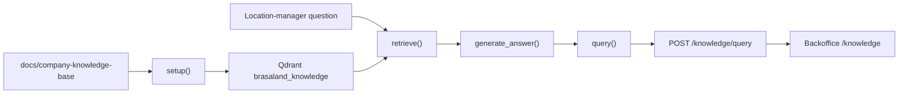

# Brasaland RAG knowledge base

This is the stack a location manager uses to ask a question about the official Brasaland manuals and read one English answer. Indexing and answering do not use LangChain or LlamaIndex.

The four manuals live in `docs/company-knowledge-base/`:

- `brasaland-loyalty-program.en.md` (`loyalty-program`)
- `brasaland-waste-protocol.en.md` (`waste-protocol`)
- `brasaland-menu-allergens.en.md` (`menu-allergens`)
- `brasaland-supplier-ordering.en.md` (`supplier-ordering`)

`setup()` reads only those files. It does not add outside text.

## 1. RAG process

1. The four manuals are copied into `docs/company-knowledge-base/`.
2. `setup()` in `data/process/rag.py` splits each manual into chunks, calls `embed()` on each chunk, and upserts the points into Qdrant.
3. Qdrant stores the collection `brasaland_knowledge`. On this machine the collection is green, distance is Cosine, vector size is 1024, and the point count is 18.
4. `retrieve()` in `data/pipelines/rag.py` embeds the question with the same `embed()` function, searches Qdrant, and returns payload dictionaries whose score is at least `min_score`. It does not return scores or vectors.
5. `generate_answer()` sends the question and those payloads to the generation model. It does not search Qdrant.
6. `query()` calls `retrieve()` and then `generate_answer()`. It returns one string.
7. `POST /knowledge/query` accepts `{"question": "..."}` and returns `{"answer": "..."}`. The route calls `query()`. It does not embed, search, or call the generation model itself. A blank question is rejected. If Qdrant or the model call fails, the response is HTTP 503 with `{"detail": "Knowledge service is unavailable"}`.
8. The backoffice page `uis/backoffice/app/knowledge/page.tsx` (`http://localhost:3001/knowledge`) posts the typed question to that endpoint and shows the `answer` string. It does not request or display chunks or scores.

Host commands, from the repo root, with `QDRANT_URL=http://127.0.0.1:6333` and the model settings in `.env`:

- Index: `uv run --project services/api python data/process/rag.py`
- Sample questions: `uv run --project services/api python data/pipelines/rag.py`
- API under Compose: the `api` service sets `QDRANT_URL=http://qdrant:6333` and depends on the `qdrant` service. Qdrant publishes `127.0.0.1:6333` and stores data in the `qdrant_data` volume.
- UI: from `uis/backoffice`, `npm run dev`, then open `http://localhost:3001/knowledge`. Use `localhost`. The backoffice theme tokens are light only, so the page stays light.

Each point payload is `company` (`brasaland`), `source_document`, `section`, `language` (`en`), `chunk_index`, and `text`. The point id is a UUID5 of those four identity fields, so a later `setup()` updates the same 18 points.

## 2. Chunking strategy

The manuals are short and already grouped into blank-line blocks: a title, a tier or dish list, and a numbered procedure. `setup()` splits on blank lines and keeps each block whole. It does not use a fixed character window, and it does not index a whole manual as one point or a single line as one point.

The first block of a file keeps the `#` title with that block. Later blocks are the blank-line section as written. The section label is the line that ends with a colon, a short label before a colon, the document title for the opening block, or the first sentence when the block has none of those. `chunk_index` starts at 0 for each section name. In the current manuals every section name is unique, so every `chunk_index` is 0.

Amounts, percentages, weights, and allergen sentences that must stay intact are checked after the split. A phrase that lands in zero chunks or in more than one chunk stops `setup()`.

Measured from the four files currently in `docs/company-knowledge-base/`:

| Source document | Chunks | Characters per chunk | Words per chunk |
| --- | ---: | --- | --- |
| loyalty-program | 5 | 216–457, average 280 | 36–77, average 47 |
| waste-protocol | 5 | 179–354, average 230 | 25–58, average 35 |
| menu-allergens | 4 | 129–466, average 300 | 22–70, average 45 |
| supplier-ordering | 4 | 126–384, average 236 | 19–52, average 34 |
| Total | 18 | | |

The live collection point count is 18, one point per chunk.

## 3. Embedding practices

`embed()` and the generation call use different model ids. The indexed collection and the answers measured for this branch used:

- Embedding model: `downtown-miami/openrouter/perplexity/pplx-embed-v1-0.6b`
- Generation model: `downtown-miami/openrouter/openai/gpt-6-luna`
- Vector dimension: 1024
- Qdrant distance: Cosine

`embed()` refuses to run when the two model ids are the same. The embedding request goes to `{EMBEDDING_BASE_URL}/embeddings`. The generation request goes to `{GENERATION_BASE_URL}/chat/completions` when that variable is set, and otherwise to the embedding base URL. The same fallback applies to the API key. `.env.example` leaves the secrets empty. `EMBEDDING_DIMENSION` is optional; when it is set, `embed()` rejects a vector whose length does not match. `setup()` creates `brasaland_knowledge` with the length of the first returned vector and Cosine distance. If the collection already exists with a different size, `setup()` stops.

`retrieve()` defaults to `min_score` 0.45. On this embedding model, correct sections for the Gold-tier and BBQ Ribs questions scored 0.533 to 0.610. The next unrelated sections scored at most 0.331, and an off-topic question peaked at 0.196. A threshold of 0.75 removed every correct chunk. 0.45 sits in the gap between the correct sections and the unrelated ones. Scores below 0.45 are dropped, so a search can return fewer payloads than `k`. When none remain, `generate_answer()` still calls the model and tells it to reply with exactly: "There is not enough information in the Brasaland manuals to answer that."

Allergen wording, currency, and numeric faithfulness are instructions to the generation model, plus a separate eval check. They are not a second retrieval filter.

- The system prompt tells the model it is a Brasaland salesperson answering a location manager from Operations or Marketing, in English, using only the retrieved text.
- For allergens it must follow the manual wording in the context and must not say or imply "zero risk". The prompt quotes the manual line that "Zero cross-contamination risk" is never guaranteed.
- Dollar and Colombian peso amounts must be copied as written. The prompt forbids currency conversion. There is no conversion step in the code.
- The prompt forbids a percentage, amount, or kilogram weight unless that number is in the retrieved context.
- `data/eval/eval_retrieval.py` calls `retrieve(question, k=3, min_score=0)` for the eight questions in `data/eval/test-queries.json`, then `generate_answer()` on those payloads. It flags a digit token in the answer when that token is not a digit token in the retrieved chunk text. The latest run was Recall@3 8/8 and 0 faithfulness flags. The HTTP route does not run that check before it returns the answer.

Unit tests in `tests/pipelines/test_rag.py` mock Qdrant and the model. They do not need a live collection or an API key. Run them with `uv run --project services/api pytest tests/pipelines/test_rag.py`.
