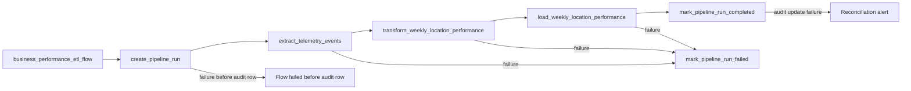

# Prefect Design: Weekly Location Cost & Waste Pipeline

Status: orchestration design only. Prefect is not a repository dependency, and this milestone adds no flow, task, deployment, worker, or configuration block.

## 1. Main flow

**Name:** `business_performance_etl_flow`

**Responsibility:** Coordinate a bounded extract, deterministic KPI transformation, and idempotent load for the Weekly Location Cost & Waste Report, while keeping `reporting.pipeline_runs` synchronized with the orchestration state.

### Parameters

| Parameter | Type | Rule |
| --- | --- | --- |
| `week_start` | `date nullable` | Optional ISO Monday. Defaults to the most recently completed UTC week. |
| `trigger_type` | `schedule \| manual \| backfill` | Identifies why the run started. |
| `reprocess_window_days` | `integer` | Defaults to `14` for scheduled runs; must be positive and bounded. |
| `batch_size` | `integer` | Positive extraction page size from configuration. |

The flow calculates a half-open UTC source window, creates a `reporting.pipeline_runs` record, and passes the same `run_id` through every task.

## 2. Execution graph

The three ETL tasks execute in order. Load cannot start without a successful transformation, and the successful watermark advances only after load commits.

## 3. Task contracts

### 3.1 `extract_telemetry_events`

**Responsibility**

Read the bounded UTC window from read-only Supabase `public.telemetry_events`, filter to the five business event types, page deterministically, and deduplicate by source `id` after the inventory-capture prerequisite maps stable producer `eventId` to that database ID.

**Inputs**

- `run_id: UUID`
- `window_start: datetime` in UTC
- `window_end: datetime` in UTC, exclusive
- `event_types: tuple[str, ...]`
- `batch_size: int`
- Supabase credentials block

**Output**

An immutable extract reference or serializable collection containing `id`, `timestamp`, `event_type`, and parsed `tags`, plus counts for extracted and duplicate rows.

**Failure conditions**

- missing credentials;
- source connection or timeout exhaustion;
- non-list REST response;
- malformed pagination response;
- duplicate `id` values with conflicting payloads; or
- an unbounded or invalid source window.

**Retry**

Three attempts for transient HTTP `429`, timeout, connection, and `5xx` failures using exponential backoff with jitter. Authentication, contract, and parameter failures are not retried. A retry restarts the bounded extraction; it does not continue from an unverified partial page.

### 3.2 `transform_weekly_location_performance`

**Responsibility**

Validate and normalize source events, calculate event-level costs, assign UTC ISO weeks, reject invalid records, and aggregate the five KPIs by location/week.

**Inputs**

- `run_id: UUID`
- immutable extract output
- country/currency allowlist

**Output**

- rows at `(location_id, week_start)` grain for `reporting.weekly_location_performance`;
- rejection records with source ID and reason code;
- extracted, transformed, rejected, and duplicate counts; and
- run-level validation status.

**Validation**

- timezone-aware parseable timestamp;
- recognized event type;
- object payload;
- required source fields;
- `CO`/`COP` or `US`/`USD`;
- positive quantity and unit cost for cost events;
- one consistent country/currency pair per location/week; and
- decimal monetary arithmetic.

**Failure conditions**

- extract contract mismatch;
- conflicting duplicate IDs;
- country/currency conflict;
- arithmetic or grouping failure; or
- an invalid KPI-bearing record that can change a destination value.

A malformed `outbound_order_created` context event may be rejected and counted without failing the task because it does not feed a v1 KPI. Invalid KPI-bearing events fail the task, so no destination partition from that run is published.

**Retry**

No automatic retry for deterministic data or validation failures. One task retry is permitted only for transient artifact-access failure. Corrected data or code is reprocessed through a new run.

### 3.3 `load_weekly_location_performance`

**Responsibility**

Revalidate ownership of the unexpired pipeline lease and transactionally upsert complete aggregates into `reporting.weekly_location_performance` on `(location_id, week_start)`.

**Inputs**

- `run_id: UUID`
- transformed rows
- affected week list
- run-level validation status
- Supabase/database credentials block

**Output**

- number of rows inserted or updated;
- committed weekly partitions;
- `computed_at`; and
- destination reconciliation result.

**Destination and idempotency**

- destination: `reporting.weekly_location_performance`;
- conflict key: `(location_id, week_start)`;
- update behavior: replace all computed KPI fields, country, currency, and `computed_at`;
- one transaction for the complete requested run window; and
- no additive update of prior aggregate totals.

The transaction locks the `reporting.pipeline_runs` row for `run_id` and verifies `status = 'running'` and an unexpired lease before writing. A stale process that lost its lease fails without publishing.

**Failure conditions**

- absent, expired, or superseded pipeline lease;
- destination connection failure;
- unique or check constraint failure;
- row-count reconciliation failure;
- transaction commit failure; or
- attempt to publish a validation-failed run.

**Retry**

Three attempts for transient connection, timeout, serialization, or deadlock failures with exponential backoff and jitter. Constraint and validation failures are not retried. Transaction rollback plus upsert makes a retry safe.

## 4. Supporting tasks

The flow may use small orchestration tasks without reducing the required three-task ETL boundary:

- `create_pipeline_run`: atomically acquire the single renewable lease for `weekly_location_cost_waste` and insert the `running` audit row;
- `mark_pipeline_run_completed`: reconcile counts, set `success`, record `finished_at`, and advance the watermark;
- `mark_pipeline_run_failed`: preserve counts and checkpoint, set `failed`, and store a sanitized error summary.

These tasks manage orchestration metadata only; they do not calculate KPIs.

The later control-table migration will enforce at most one unexpired active lease for `pipeline_name`. The flow heartbeats `heartbeat_at` and extends `lease_expires_at`. A trigger presented with a live lease returns `409` and its `run_id`; after expiry, one transaction marks the orphaned run failed and acquires the replacement lease. This reservation occurs before extraction, serializing all scheduled, manual, and backfill windows.

## 5. States and failure propagation

| Prefect state | Pipeline-run state | Meaning |
| --- | --- | --- |
| `Pending` | no row yet | Parameters are being validated; no pipeline lease is held. |
| `Running` | `running` | The renewable pipeline lease is held and ETL is active. |
| `Completed` | `success` | Load committed, reconciliation passed, and watermark advanced. |
| `Failed` | `failed` | A critical task failed and no successful watermark was recorded. |

Extraction, transformation, and loading are critical. A failed critical task prevents downstream execution. The state handler attempts to update the audit row; failure to update that row is logged separately and does not falsely report success.

## 6. Logging and observability

Every task log includes `run_id`, flow-run ID, task-run ID, pipeline version, source window, and stage. Logs must not include credentials, staff identity, or raw payloads.

The flow records:

- start and finish timestamps;
- source watermarks;
- heartbeat and lease expiry;
- rows extracted, transformed, loaded, rejected, and skipped as duplicates;
- duration;
- last completed stage;
- destination partitions;
- retry count; and
- sanitized error stage and summary.

Alerts are designed for a missing Monday run, an over-SLA `Running` run, terminal failure, source-event collapse, and unusual duplicate/rejection growth.

## 7. Configuration blocks

### `SupabaseCredentials`

Secret block containing:

- Supabase URL;
- service-role key for server-side reads and future reporting writes.

The current environment variable names are `SUPABASE_URL` and `SUPABASE_SERVICE_ROLE_KEY`. The block replaces direct environment lookup inside Prefect tasks without exposing secrets to API responses or logs.

### `BusinessPipelineConfig`

Non-secret block containing:

- source table: `public.telemetry_events`;
- destination table: `reporting.weekly_location_performance`;
- run-log table: `reporting.pipeline_runs`;
- event-type allowlist;
- batch size;
- 14-day scheduled reprocess window;
- retry limits and delays;
- expected country/currency pairs; and
- publication SLA once leadership supplies the exact Monday time.

## 8. Scheduling and manual execution

- One scheduled deployment starts each Monday after the prior UTC week closes. The exact Monday-morning time is unresolved in the briefing and must be approved before implementation.
- `POST /reporting/pipeline-runs` requests the same flow through a deployment or orchestration adapter; FastAPI does not execute ETL inline.
- Any active scheduled, manual, or backfill run with a live pipeline lease causes a new trigger to return `409`. Serialization begins before extraction, so overlapping windows cannot publish stale snapshots.
- A bounded historical request uses the same main flow with `trigger_type = backfill`; Part 1 does not require a second flow.

## 9. Recovery behavior

- Source outage: retry extraction; on exhaustion, fail without advancing the watermark.
- Process crash during extract: restart the entire bounded extract.
- Transmission retry: deployment is blocked until an integration check proves inventory capture reuses producer `eventId` as `telemetry_events.id`; row data alone cannot prove how its ID was generated.
- Transform contract failure: stop, preserve rejection evidence, and wait for correction.
- Destination outage or deadlock: roll back and retry the load task.
- Crash after destination commit: rerun the same upsert and reconcile before success; the unique key prevents duplicate aggregate rows.
- Flow crash: heartbeat expiry permits one atomic takeover; a resumed stale process fails lease validation before load.
- Late data: scheduled 14-day overlap recomputes two complete weeks.
- Older correction: run a bounded backfill for the affected week.

## 10. Proposed implementation boundaries

Future implementation, not Part 1:

- `data/pipelines/business_performance/flow.py`: flow and task orchestration;
- `data/pipelines/business_performance/repository.py`: source/destination and run-log access;
- `data/process/business_performance.py`: pure validation and KPI calculation;
- `services/reporting/`: HTTP routes and models that call pipeline-facing functions.

Dependencies point from `services/reporting/` to `data/pipelines/`, and from pipeline orchestration to pure `data/process/` functions. Pipeline modules do not import the API service. Existing `services/telemetry/` remains independent.

`services/reporting/` is a module mounted by the existing `services/api` FastAPI application and reuses its staff authentication dependencies; it is not a second deployable API. Part 2 must update packaging so the existing API image includes the reporting and pipeline modules, because its current Docker build context includes only `services/api`.
