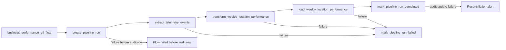

# Prefect Design: Weekly Location Cost & Waste Pipeline

Status: Phase 4 orchestration design only. Prefect is not a repository dependency, and this milestone adds no flow, task, deployment, worker, or configuration block. Reliability decisions below agree with Phase 3 in root [`PIPELINE_DESIGN.md`](../../PIPELINE_DESIGN.md) and [`data/pipelines/PIPELINE_DESIGN.md`](../../data/pipelines/PIPELINE_DESIGN.md).

Location: `docs/telemetry/PREFECT_DESIGN.md`, beside the technical telemetry report.

## 1. Main flow

**Proposed name:** `business_performance_etl_flow`

**Responsibility:** Coordinate the complete Weekly Location Cost & Waste Report pipeline: acquire a renewable pre-extract lease, extract a bounded UTC window from read-only `public.telemetry_events`, transform deterministic location/week KPIs, transactionally load and reconcile `reporting.weekly_location_performance`, and keep `reporting.pipeline_runs` synchronized with orchestration state.

A second flow is not required for Part 1. Scheduled, manual, and backfill triggers reuse this flow with different parameters. Part 1 does not define a separate technical-telemetry or alerting flow.

### 1.1 Flow parameters

| Parameter | Type | Rule |
| --- | --- | --- |
| `week_start` | `date nullable` | Optional ISO Monday. Defaults to the most recently completed UTC week. |
| `trigger_type` | `schedule \| manual \| backfill` | Identifies why the run started. |
| `reprocess_window_days` | `integer` | Defaults to `14` for scheduled runs; must be positive and bounded. |
| `batch_size` | `integer` | Positive extraction page size from configuration. |

The flow calculates a half-open UTC source window, creates a `reporting.pipeline_runs` record, and passes the same `run_id` through every task.

## 2. Task execution order and dependencies

The three ETL tasks execute strictly in series. Supporting audit tasks bracket them but do not replace the extract → transform → load boundary.

| Order | Task | Depends on | May start only when |
| --- | --- | --- | --- |
| 1 | `create_pipeline_run` | flow parameters validated | No live lease exists for `weekly_location_cost_waste`, or an expired orphan is takeover-eligible. |
| 2 | `extract_telemetry_events` | successful lease and audit row | `run_id` is `running` with an unexpired lease. |
| 3 | `transform_weekly_location_performance` | successful extract | Immutable extract artifact or serializable extract output is available. |
| 4 | `load_weekly_location_performance` | successful transform | Transform produced a validation-passing destination set for the requested window. |
| 5 | `mark_pipeline_run_completed` | successful load | Destination transaction committed and row-count reconciliation passed. |

Failure of any critical ETL task stops downstream tasks. The flow state handler calls `mark_pipeline_run_failed` when an audit row already exists. Watermark advancement occurs only after load success and completion marking.

## 3. Task 1 — Extraction

**Proposed name:** `extract_telemetry_events`

### Responsibility

Read the bounded UTC window from read-only Supabase `public.telemetry_events`, filter to the five business event types, page deterministically by `(timestamp ASC, id ASC)`, and deduplicate by source `id` after the inventory-capture prerequisite maps stable producer `eventId` to that database ID.

### Inputs

- `run_id: UUID`
- `window_start: datetime` in UTC
- `window_end: datetime` in UTC, exclusive
- `event_types: tuple[str, ...]`
- `batch_size: int`
- `SupabaseCredentials` block

### Outputs

An immutable extract reference or serializable collection containing `id`, `timestamp`, `event_type`, and parsed `tags`, plus counts for extracted and duplicate rows written back to the run record.

### Failure conditions

- missing credentials;
- source connection or timeout exhaustion;
- non-list REST response;
- malformed pagination response;
- duplicate `id` values with conflicting payloads; or
- an unbounded or invalid source window.

### Retry behavior

Three attempts for transient HTTP `429`, timeout, connection, and `5xx` failures using exponential backoff with jitter. Authentication, contract, and parameter failures are not retried. A retry restarts the entire bounded extraction; it does not continue from an unverified partial page. Incomplete extracts are discarded, matching Phase 3 interrupted-extraction recovery.

## 4. Task 2 — Transformation

**Proposed name:** `transform_weekly_location_performance`

### Responsibility

Validate and normalize source events, calculate event-level costs, assign UTC ISO weeks, reject invalid records, and aggregate the five KPIs by `(location_id, week_start)`.

### Inputs

- `run_id: UUID`
- immutable extract output from Task 1
- country/currency allowlist from `BusinessPipelineConfig`

### Outputs

- rows at `(location_id, week_start)` grain for `reporting.weekly_location_performance`;
- rejection records with source ID and reason code;
- extracted, transformed, rejected, and duplicate counts; and
- run-level validation status.

### Validation

- timezone-aware parseable timestamp;
- recognized event type;
- object payload;
- required source fields;
- `CO`/`COP` or `US`/`USD`;
- positive quantity and unit cost for cost events;
- one consistent country/currency pair per location/week; and
- decimal monetary arithmetic.

### Failure conditions

- extract contract mismatch;
- conflicting duplicate IDs;
- country/currency conflict;
- arithmetic or grouping failure; or
- an invalid KPI-bearing record that can change a destination value.

A malformed `outbound_order_created` context event may be rejected and counted without failing the task because it does not feed a v1 KPI. Invalid KPI-bearing events fail the task, so no destination partition from that run is published.

### Retry behavior

No automatic retry for deterministic data or validation failures. One task retry is permitted only for transient artifact-access failure. Corrected data or code is reprocessed through a new run that restarts the bounded window. Stage markers are audit-only; they are not mid-transform resume pointers.

## 5. Task 3 — Loading

**Proposed name:** `load_weekly_location_performance`

### Responsibility

Revalidate ownership of the unexpired pipeline lease and transactionally publish complete aggregates into `reporting.weekly_location_performance`.

### Inputs

- `run_id: UUID`
- transformed rows from Task 2
- affected week list
- run-level validation status
- Supabase/database credentials block

### Outputs

- number of rows inserted or updated;
- number of stale location-week rows deleted by reconciliation;
- committed weekly partitions;
- `computed_at`; and
- destination reconciliation result.

### Destination handling

- destination table: `reporting.weekly_location_performance`;
- conflict key: `(location_id, week_start)`;
- one database transaction for the complete requested run window;
- lock and revalidate the `reporting.pipeline_runs` row for `run_id` before writing;
- require `status = 'running'` and an unexpired lease; and
- refuse publication when the transform validation status is failed.

### Idempotency

- `INSERT ... ON CONFLICT (location_id, week_start) DO UPDATE` replaces country, currency, all KPI fields, and `computed_at`;
- updates are replacement, never additive increments;
- within the same transaction, delete existing rows for each affected `week_start` whose `location_id` is absent from the recomputed set; and
- repeated successful execution of the same bounded window yields the same business results without duplicate destination rows.

### Failure conditions

- absent, expired, or superseded pipeline lease;
- destination connection failure;
- unique or check constraint failure;
- row-count reconciliation failure;
- transaction commit failure; or
- attempt to publish a validation-failed run.

### Retry behavior

Three attempts for transient connection, timeout, serialization, or deadlock failures with exponential backoff and jitter. Constraint and validation failures are not retried. Transaction rollback plus upsert-and-reconcile makes a retry safe. A crash after destination commit but before success logging is recovered by a later run of the same window; unique keys and reconcile deletes keep the result correct.

## 6. Supporting orchestration tasks

The flow may use small orchestration tasks without reducing the required three-task ETL boundary:

- `create_pipeline_run`: atomically acquire the single renewable lease for `weekly_location_cost_waste` and insert the `running` audit row;
- `mark_pipeline_run_completed`: reconcile counts, set `success`, record `finished_at`, and advance the watermark;
- `mark_pipeline_run_failed`: preserve counts and audit stage marker, set `failed`, and store a sanitized error summary.

These tasks manage orchestration metadata only; they do not calculate KPIs.

The later control-table migration will enforce at most one unexpired active lease for `pipeline_name`. The flow heartbeats `heartbeat_at` and extends `lease_expires_at`. A trigger presented with a live lease returns `409` and its `run_id`; after expiry, one transaction marks the orphaned run failed and acquires the replacement lease. This reservation occurs before extraction, serializing all scheduled, manual, and backfill windows.

## 7. Logging

Every task log includes `run_id`, Prefect flow-run ID, task-run ID, pipeline version, source window, and stage. Logs must not include credentials, staff identity, or raw payloads.

The flow records the Phase 3 observability fields on `reporting.pipeline_runs`:

- start and finish timestamps;
- execution status;
- source watermarks;
- heartbeat and lease expiry;
- rows extracted, transformed, loaded, rejected, and skipped as duplicates;
- duration;
- last completed stage as an audit marker only;
- destination partitions;
- retry count; and
- sanitized error stage and summary.

Alerts are designed for a missing Monday run, an over-SLA `Running` run, terminal failure, lease-expiry without status update, source-event collapse, and unusual duplicate/rejection growth.

## 8. Retry configuration

| Scope | Attempts | Policy |
| --- | --- | --- |
| Extract transient transport failures | 3 | Exponential backoff with jitter |
| Transform transient artifact access | 1 | No retry for validation or data defects |
| Load transient destination failures | 3 | Exponential backoff with jitter; rollback then retry |
| Auth, contract, constraint, and validation failures | 0 | Fail immediately; wait for correction |
| Incomplete extract / interrupted pagination | n/a | Discard partial pages and restart the bounded window |

Retry counts are recorded on the run. Exhaustion marks the Prefect task and flow failed and does not advance the scheduled watermark.

## 9. Failure propagation and execution status

| Prefect state | Pipeline-run state | Meaning |
| --- | --- | --- |
| `Pending` | no row yet | Parameters are being validated; no pipeline lease is held. |
| `Running` | `running` | The renewable pipeline lease is held and ETL is active. |
| `Completed` | `success` | Load committed, reconciliation passed, and watermark advanced. |
| `Failed` | `failed` | A critical task failed and no successful watermark was recorded. |

Extraction, transformation, and loading are critical. A failed critical task prevents downstream execution. The state handler attempts to update the audit row; failure to update that row is logged separately and does not falsely report success.

## 10. Recovery behavior

Aligned with Phase 3 recoverability:

| Failure | Prefect recovery |
| --- | --- |
| Source database connection failure | Retry extract up to three times; on exhaustion fail the flow without destination writes or watermark advance. |
| Interrupted extraction | Discard incomplete extract and restart the bounded window. |
| Transformation failure | Fail transform and flow; preserve rejection evidence; no load. |
| Partial processing | Do not publish; load is all-or-nothing for the requested window. |
| Destination write failure | Roll back, retry load up to three times; on exhaustion leave prior successful rows intact. |
| Safe re-execution | Same window + deterministic aggregates + upsert and reconcile deletes. |
| Historical backfill | Same main flow with `trigger_type = backfill` and explicit week bounds; failed backfill does not rewrite the incremental watermark. |
| Process crash before load | Heartbeat stops; after lease expiry a replacement run takes over and restarts the window. |
| Crash after destination commit | Replacement run upserts and reconciles the same window, then marks success. |
| Offline or buffered capture | Blocked until capture reuses producer `eventId` as `telemetry_events.id`; week assignment uses event time. |

## 11. Configuration blocks

### `SupabaseCredentials`

Secret block containing:

- Supabase URL;
- service-role key for server-side reads and future reporting writes.

The current environment variable names are `SUPABASE_URL` and `SUPABASE_SERVICE_ROLE_KEY`. The block replaces direct environment lookup inside Prefect tasks without exposing secrets to API responses or logs.

### `BusinessPipelineConfig`

Non-secret block containing:

- source table: `public.telemetry_events`;
- destination table: `reporting.weekly_location_performance`;
- run-log table: `reporting.pipeline_runs`;
- event-type allowlist;
- batch size;
- 14-day scheduled reprocess window;
- retry limits and delays;
- expected country/currency pairs; and
- publication SLA once leadership supplies the exact Monday time.

## 12. Scheduling and manual execution

- One scheduled deployment starts each Monday after the prior UTC week closes. The exact Monday-morning time is unresolved in the briefing and must be approved before implementation.
- `POST /reporting/pipeline-runs` requests the same flow through a deployment or orchestration adapter; FastAPI does not execute ETL inline.
- Any active scheduled, manual, or backfill run with a live pipeline lease causes a new trigger to return `409`. Serialization begins before extraction, so overlapping windows cannot publish stale snapshots.
- A bounded historical request uses the same main flow with `trigger_type = backfill`; Part 1 does not require a second flow.

## 13. Proposed implementation organization

All names and paths below are proposals for a later implementation phase. Part 1 creates no modules, Prefect package, or dependency.

| Proposed path | Role |
| --- | --- |
| `services/reporting/` | HTTP adapters, request/response models, and mount into the existing FastAPI app. Reserved empty boundary already exists. |
| `services/reporting/router.py` | Proposed routes: pipeline status, manual trigger, and KPI query. |
| `services/reporting/schemas.py` | Proposed Pydantic request and response models. |
| `services/reporting/deps.py` | Proposed reuse of existing staff JWT/session dependencies from `services/api`. |
| `data/pipelines/business_performance/flow.py` | Proposed Prefect flow and task definitions. |
| `data/pipelines/business_performance/repository.py` | Proposed source, destination, and run-log access. |
| `data/process/business_performance.py` | Proposed pure validation and KPI calculation. |

Dependency direction:

- `services/reporting/` → `data/pipelines/` → `data/process/`
- Pipeline modules do not import the HTTP service.
- Existing `services/telemetry/` remains independent and is not reused for business KPI calculation.

`services/reporting/` is a module mounted by the existing `services/api` FastAPI application and reuses its staff authentication dependencies; it is not a second deployable API. Part 2 must update packaging so the existing API image includes the reporting and pipeline modules, because its current Docker build context includes only `services/api`.

## 14. Phase 4 acceptance summary

- One main flow is defined: `business_performance_etl_flow`.
- At least three ETL tasks are defined: extract, transform, and load.
- Task order, dependencies, parameters, logging, retries, failure propagation, execution status, and recovery are specified.
- Reliability decisions agree with Phase 3: non-additive upsert, transactional stale-row reconcile, renewable lease, restart-window recovery, and watermark-after-success.
- Organization uses the reserved `services/reporting/` boundary; module paths are proposals only.
- No Prefect code, dependency, deployment, or worker is added in this phase.
